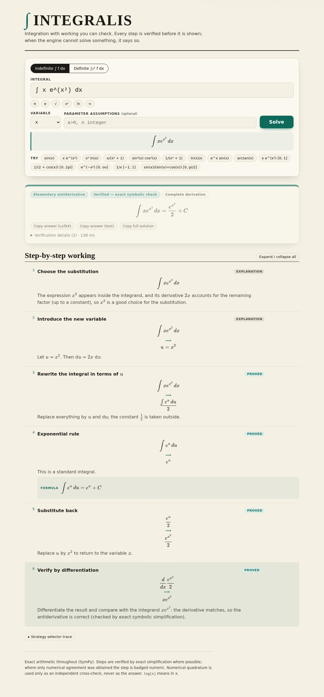

# INTEGRALIS

A symbolic **integration** calculator (indefinite, definite and improper integrals) whose defining feature is
**working you can check**: every derivation step is stored as structured data and *verified before it can be shown*.
When the engine cannot solve something it says so, and it never presents a number just because a numerical routine
produced one.



* Backend: Python 3.10+, **SymPy** (exact arithmetic) + an orchestration layer of 17 techniques, **mpmath** (independent numerics), **FastAPI**
* Frontend: **React + TypeScript + KaTeX** (Vite)
* Tests: **pytest** (291 tests; answers *and* displayed working are re-verified with independent numerics)

## Quick start

```bash
# 1. backend (from backend/)
python -m venv .venv && source .venv/bin/activate
pip install -r requirements.txt
uvicorn integralis.api.app:app --reload           # http://127.0.0.1:8000  (interactive API docs at /docs)

# 2. frontend (from frontend/), in a second terminal
npm install
npm run dev                                        # http://localhost:5173  (proxies /api to :8000)
# or:  npm run build   -> frontend/dist is then served by the backend itself at http://127.0.0.1:8000

# 3. tests (from backend/)
pip install -r requirements-dev.txt && pytest
```

No FastAPI available? `python -m integralis.devserver --port 8000` serves the *same* JSON API and the built frontend using only the
standard library (a prebuilt `frontend/dist` is included). Python use without any server:

```python
from integralis import solve
r = solve("∫ x e^(x²) dx")
r.antiderivative          # exp(x**2)/2
r.verification_status     # 'verified'
for step in r.steps: print(step.title, step.verification.value)

r = solve("1/(2+cos(x))", lower="0", upper="2*pi")      # 2*pi*sqrt(3)/3  (see 'spurious jumps' below)
```

## Notation

`sin(x)`, `sin x`, `sin 2x`, `sin^2 x`, `x e^(x²)`, `2x(x+1)`, `xsinx`, `sqrt(1-x^2)`, `√x`, `|x−1|`, `exp(x^2)`, `arctan(x)`, `ln(x)`,
`log10(x)`, `x²`, `π`, `∞`, `∫_0^1 x² dx`, `∫₀¹ x dx`. Limits accept `oo`, `-oo`, `pi/2`, `2sqrt(3)` … Decimals are read as exact rationals.
`log(x)` is the **natural** logarithm (university convention; a warning says so) — use `log10(x)` for base 10. `1/2x` is `(1/2)·x` (a
warning is shown for `a/bc`). Parameters other than the integration variable are real constants; declare assumptions such as
`a>0, n integer` in the UI (or `assumptions` in the API) when a result depends on them.

## What the engine returns

| classification | meaning |
|---|---|
| `elementary` | an elementary antiderivative, verified by differentiation |
| `special_function` | a closed form using `erf`, `Ei`, `Si`, `Ci`, `li`, … (verified; the derivation is flagged *result only* / *partial*) |
| `non_elementary_proven` | the Risch decision procedure established that **no elementary antiderivative exists** (only claimed when proved) |
| `no_closed_form_found` | nothing found — explicitly **not** a proof of non-existence |
| `could_not_solve` | time limit / internal limit reached |
| `exact_value` (definite) | exact value; cross-checked by 30-digit quadrature where reliable |
| `divergent` (definite) | the improper integral diverges; no value is assigned |

## How correctness is enforced

1. **Steps are claims.** `derivation.make_step` is the only way a step is created. Its claims (`lhs == rhs`, or `dF/dx == f`) are checked first;
   a failed claim raises `UnjustifiedStepError`, so an invented or wrong transformation cannot be displayed.
2. **Two evidence levels, always labelled.** *proved* = exact symbolic simplification (or identical expressions); *numeric* = agreement to
   ~28 digits at many sample points when simplification was inconclusive. Numerical agreement is never called a proof.
3. **Every technique result is re-verified by the engine** by differentiation before it is accepted; if it fails, the next strategy is tried.
4. **Definite integrals are guarded against classic traps**: interior singularities (`∫₋₁¹ 1/x² dx` diverges), spurious jumps of an antiderivative
   (`∫₀^2π dx/(2+cos x)` — a naive `F(2π)−F(0)` gives 0, the true value is `2π/√3`), divergence vs. convergence decided by exact limits or p-tests *before*
   any value is reported, and an independent `mpmath` quadrature cross-check (reported as evidence).
5. **Safe parser**: a hand-written tokenizer/recursive-descent parser with a whitelist of functions — `eval`/`exec` are never used.

## Architecture (backend/integralis)

| concern | module |
|---|---|
| parsing | `parsing/parser.py` (safe tokenizer + parser), `parsing/problem.py` (∫ notation, limits, variable) |
| strategy selection | `strategy/features.py` (structure of the integrand), `strategy/selector.py` (ranking) |
| symbolic computation | `techniques/*.py` (each delegates algebra to SymPy) |
| derivation construction | `derivation.py` (`make_step`), `models.py` (`Step`, `Claim`, `Solution`) |
| verification | `verify.py` (symbolic provers incl. a fast Pythagorean reducer, numeric cross-checks), `engine.py` (per-result verification) |
| orchestration | `engine.py` (recursion, cycle guard, two-pass fallback), `solver.py` (pipeline, classification) |
| definite / improper | `definite.py`, `definite_support.py` |
| API | `service.py` (framework-free handlers), `api/app.py` + `api/schemas.py` (FastAPI), `devserver.py` (stdlib) |
| presentation | `render.py` (LaTeX / plain text; `Msg` templates render both), frontend `components/` |

The catalogue of techniques is in [docs/TECHNIQUES.md](docs/TECHNIQUES.md); adding one is described in [docs/EXTENDING.md](docs/EXTENDING.md).

## API

`GET /api/health` · `GET /api/techniques` · `GET /api/examples` · `POST /api/parse` (LaTeX preview + precise syntax errors) ·
`POST /api/integrate`

```json
POST /api/integrate
{"expression": "x e^(x²)", "variable": "x", "mode": "definite", "lower": "0", "upper": "1",
 "assumptions": {"a": "positive"}, "timeout_seconds": 30}
```
The response contains `status` (`solved|divergent|failed`), `classification`, `answer` (LaTeX + plain text), `decimal`, `verification`
(status + individual checks), `conditions`, `warnings`, `derivation_level`, a nested `steps` tree (each step: `before`, `after`, `rule`,
`explanation`, `conditions`, `verification`, optional `formula`/`table`, `substeps`) and the strategy `trace`. Syntax errors return
HTTP 400 with `{message, position, length, hint, source}`; mathematical failures are ordinary results with an explanatory message.
Solves run in worker processes so a hard wall-clock limit can be enforced (the engine also has soft per-technique limits).

## Tests

`backend/tests/` — parser (spec examples, notation, malformed input, injection attempts), indefinite integrals by category (polynomial, trigonometric,
reverse chain rule, by parts, repeated parts, partial fractions, polynomial division, trigonometric identities, inverse trigonometric, radicals),
strategy selection, **independent re-verification of every displayed step**, definite integrals (exact, convergent/divergent improper, interior
singularities, antiderivative jumps, symmetry, King property), special functions and honest classification, parameters, **randomly generated
integrands from known antiderivatives**, malformed and unsupported input, a deliberately lying technique (rejected), and the JSON contract.
Results of the run made while building this are in [docs/TEST_RESULTS.txt](docs/TEST_RESULTS.txt); the demonstration set of difficult
integrals (computed live by `python tools/run_demo.py`) is in [docs/DEMO_RESULTS.md](docs/DEMO_RESULTS.md).

## Known limitations (please read)

* **Not a universal integrator.** It handles a broad but finite family (see the catalogue). Everything else goes to SymPy's general algorithms
  and is accepted only if it verifies; otherwise you get an honest failure, not a guess.
* Derivations for special-function results are marked *result only* / *partial*: the engine does not explain how SymPy's algorithm found them.
* Partial fractions need an exact real factorisation of the denominator (radical roots). Irreducible factors of degree ≥ 3 without radical roots fall back to SymPy.
  Trigonometric/hyperbolic substitutions cover `a²±u²` under roots and `(u²+a²)⁻ⁿ`; `(u²−a²)` under integer powers relies on partial fractions.
* Symbolic proofs can be inconclusive on complicated expressions; the step/result is then badged **numeric** (strong evidence, not a proof).
* Singularity detection for trigonometric integrands covers `tan/cot/sec/csc` with *linear* arguments; other cases produce a warning that continuity was not certified.
  Cauchy principal values are not computed (a divergent integral is reported as divergent).
* Oscillatory improper integrals (e.g. `∫₀^∞ sin x/x dx`) are evaluated exactly via special-function limits but get **no** quadrature cross-check (quadrature is unreliable there).
* Convergence tests without an antiderivative are conservative: if they cannot decide, no value is reported.
* Parametric results are valid where the integrand stays continuous; piecewise parametric results appear only through the SymPy fallback. Provide assumptions for limits that depend on a parameter's sign.
* The engine works over the reals (complex-valued integrands are out of scope). Time limits are soft (SIGALRM, main thread only); the API's process pool adds a hard limit.

## What was and was not run while building this

Run and passing: backend library, 291 tests (via a pytest-compatible stand-in because pytest could not be installed offline), the demo set, the
stdlib dev server, and the real UI in headless Chromium (indefinite, definite, divergent, syntax error, failure, mobile; no console errors).
**Not run here:** the FastAPI app itself and `tests/test_service_api.py::test_fastapi_app_if_available` (FastAPI/pydantic/httpx are not installed in the
build sandbox and there is no network) — `api/app.py` is a thin wrapper over the tested `service.py` and compiles, but please run `pytest` once on your
machine; and `npm run build` with Vite (the UI was bundled with esbuild and type-checked against loose React shims, since `@types/react` is unavailable offline).
